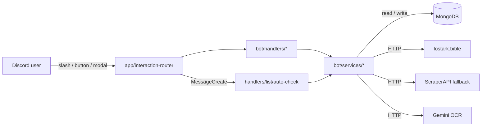

# Lost Ark Discord Bot (LoaLogs)

Discord bot for a small Lost Ark guild. It watches server status, looks up rosters on
`lostark.bible`, and keeps a shared blacklist / whitelist / watchlist that members check
with screenshots (Gemini OCR) or typed names, with Stronghold-based alt detection.

**Contents:** [Features](#features) · [Commands](#commands) · [How lists work](#how-lists-work) ·
[Screenshot checks](#screenshot-checks) · [Data](#data) · [Architecture](#architecture) ·
[Setup](#setup) · [Known limitations](#known-limitations)

## Features

- **Server monitor**: watches Thaemine and posts `@here` when it comes back online. Outside the weekly schedule it also posts once when the server goes down: "unscheduled maintenance" when the status page shows the maintenance wrench, "down" when it shows none.
- **Roster lookup**: `/la-roster` reads `lostark.bible`, tracks item-level progress and cross-checks every list; `deep:true` adds Stronghold alt detection.
- **Lists**: blacklist / whitelist / watchlist (`⛔` / `✅` / `⚠️`); blacklist entries are global or server-scoped; trusted users can never be listed.
- **Checks**: `/la-check` and the auto-check channel read names from screenshots or typed text and cross-check them against every list.
- **Approvals**: members submit, officers approve instantly, senior approvers always receive the DM.
- **Evidence**: images are rehosted to a pinned evidence channel and copied to MongoDB, so Discord's 24h CDN expiry never breaks them.
- **Bulk add**: `/la-list multiadd` takes an Excel template of up to 30 rows, with one approval DM and one broadcast.
- **ScraperAPI fallback**: `lostark.bible` is fetched directly first, then through up to 3 ScraperAPI keys on 403/503; high-fanout roster, list and OCR paths keep ScraperAPI off by default.
- **Guild only**: every slash command sets `setDMPermission(false)`; nothing runs in DMs.

## Commands

### Everyone

| Command | What it does |
|---|---|
| `/la-status` | Live server status |
| `/la-roster name [deep] [deep_limit]` | Roster, item-level change and list cross-check. `deep:true` (Stronghold alt scan) is officer/senior only, because it runs on the bot owner's residential-IP worker |
| `/la-search name [min_ilvl] [max_ilvl] [class]` | Similar names (default iLvl ≥ 1700), cross-checked, with list details even when there is no evidence image |
| `/la-evidence name [public]` | One listed name's evidence, with autocomplete over all three lists. Private by default; `public:true` is officer/senior only |
| `/la-check image [mode]` | Read names from a screenshot and cross-check them; `mode` overrides your saved mode for this image |
| `/la-check-mode [mode]` | Privately view or save your Daily/Analysis mode |
| `/la-help` | Show all commands |

### Lists

| Command | What it does |
|---|---|
| `/la-list add type name reason raid [image] [scope]` | Add an entry; `scope` (`global` / `server`) is for the blacklist only |
| `/la-list edit name [reason] [type] [raid] [image] [scope] [additional_names]` | Edit an entry |
| `/la-list add-form` · `/la-list edit-form` | The same add and edit as a form: list (with blacklist scope), name, reason, raid dropdown and an optional screenshot; the submit runs the same checks and approval flow |
| `/la-list remove name` | Remove an entry |
| `/la-list view type [scope]` | Browse entries. `scope` (`all` / `global` / `server`) narrows only the blacklist, so `type:all` with `global` or `server` shows the blacklist alone |
| `/la-list trust action name [reason]` | `add` or `remove` a trusted user (officer/senior only) |
| `/la-list enrich name [deep_limit]` | Stronghold scan of an existing entry, appending the alts it finds (officer/senior only, about 10-15 minutes) |
| `/la-list multiadd action [file]` | `action:template` downloads the Excel template, `action:file` uploads it (≤ 30 rows) |

The rules behind these commands are in [How lists work](#how-lists-work).

### Auto-check channel

| Message | What it does |
|---|---|
| A screenshot | Up to 3 images per message, 8 names each (24 in all). The result's dropdown opens Quick Add: the add form with the name filled in and blacklist chosen, answered privately |
| `check NameOne NameTwo` | Cross-check up to 8 typed names, separated by spaces, commas, semicolons or new lines. A listed hit opens a detail card with cached iLvl/CP, who added it, tracked alts and evidence |
| `roster NameOne` (or `roster: NameOne`) | One roster lookup, like plain `/la-roster` with no deep scan. Shares the text-check cooldown and works without OCR |

### Server setup

`/la-setup config action:<action>` (Manage Server permission):

| Action | What it does |
|---|---|
| `show` | Show the current config |
| `set-auto-channel channel:#x` · `set-notify-channel channel:#x` | Set the auto-check or the notification channel |
| `cleanup-on` / `cleanup-off` | Daily cleanup of the auto-check channel |
| `notify-cleanup-on` / `notify-cleanup-off` | Notification-channel sweep every 30 minutes (off by default) |
| `notify-cleanup` | Run one notification-channel sweep now |
| `notify-on` / `notify-off` | Global-list notifications |
| `set-default-scope scope:global/server` | Default scope for `/la-list add` |
| `set-language` · `repin` · `notify-repin` | Set the public language · clear non-pinned auto-check messages and refresh its guide · refresh the notification guide |

### Owner server

`/la-stats`, `/la-remote` and `/la-reset` are registered only in `OWNER_GUILD_ID` and listed in
`/la-help` there. Each also checks `SENIOR_APPROVER_IDS` in its handler: registration alone is
not a permission.

- `/la-stats`: process-lifetime ScraperAPI request totals, success/failure split, network errors and per-key counts.
- `/la-reset`: clears the stored server status; the next check starts over without an online alert.
- `/la-remote action:<action>`: `view`, `evidencechannel` (sets the evidence channel), `defaultscope`, `syncimages` and `leave`.
  - `syncimages` copies images archived before the database copy existed into MongoDB, up to 12 minutes per run.
  - `leave guild:<server>` removes the bot from a server after a confirmation card. Only the application owner (the Developer Portal owner, also in `SENIOR_APPROVER_IDS`) may use it. The `guild` option suggests server names. The owner server and any server holding a channel named in `CHANNEL_ID`, `LIST_NOTIFY_CHANNEL_IDS` or `AUTO_CHECK_CHANNEL_IDS` are refused, and the server's saved settings and entries stay.

### Status icons

| Icon | Meaning |
|---|---|
| ⛔ | Blacklisted |
| ✅ | Whitelisted |
| ⚠️ | Watchlist (under investigation) |
| ❓ | Not in any list, roster exists |
| 🛡️ | Trusted user (cannot be added to any list) |
| `[S]` | Server-scoped blacklist entry |
| `[S:Name]` | Server-scoped entry with its server name (owner view) |

## How lists work

**Scope.** Blacklist entries are `global` or `server`. When both exist for one name, the server
entry takes precedence in view and check output. The owner guild sees every server-scoped entry
with a `[S:GuildName]` label; other guilds see their own server entries plus everything global.

**Adding.** Every add names its raid (command, form, Quick-Add and multiadd), with `Other` for a
raid outside the list, and a reason is at most 1000 characters. When the character is already listed, the duplicate card offers
**Add to history**: the typed reason and raid become the entry's latest note, the roster fetched
for the add is merged into its tracked alts, and a new screenshot replaces the evidence. The card
names who added the entry only for officers and seniors. A member's server-scoped add that finds
an entry they did not add in their own server (another member's, global, unscoped or another
server's) goes to the approvers instead, and the approver's comparison card offers
**Add to history**.

**Notes.** Once an entry has two notes, cards that show a reason add a `📜 N notes` line and a
**History** button. The history opens only for the clicker, oldest first, ten notes per page, and
names each note's writer only for officers and seniors. `/la-list edit` overwrites the latest note.

**Editing.**
- Officers and seniors edit directly.
- The owner of an entry edits a server entry directly. On a global entry they change the reason, raid and image directly; adding `additional_names`, moving it to another list or changing its scope waits for an approver.
- Editing someone else's entry always goes through approval, member approvers included, since their auto-approval covers only their own adds.
- Server-to-global promotion and moves into the global blacklist need approval unless the requester is an officer or senior.
- `additional_names` appends alts by hand for hidden-roster, no-guild cases, and stays pending with any edit that needs approval.
- In edit-form an empty field keeps the entry's value; it first asks for the `name`, which searches the entries. A custom watchlist raid and `additional_names` stay command-only.

**Removing.** Ownership is checked, and a refused removal does not name who added the entry. When
one name exists on several entries or scopes, the picker lists each match, this server's entries
first. Entries from before ownership tracking have no owner, so officers and seniors may remove
them. Typing `name` in edit and remove suggests the entries this server may see.

**Approvals.** Each pending approval accepts one decision, even when several approvers click at
once. The request stays saved while it is processed: **Retry this decision** resumes interrupted
work once its processing lease expires, and cannot reverse a decision already started. A request
nobody decides expires after 24 hours.

**Trusted users.** The protection applies to adds and to alts appended by edits or enrichment, and
is checked again when an edit or an Add to history is approved.

**Moves between lists** use MongoDB transactions, which need a replica set or sharded cluster, so
a failed move cannot leave a second copy or delete its source halfway through.

**Evidence.** Every rehosted image is also stored once in MongoDB (`evidence_images`). When Discord
reports an entry's archive message deleted or unreadable, the bot shows the image's newest live
archive copy, or posts the stored copy to the evidence channel again and points the entry at it; a
transient Discord error never re-posts. An entry written straight to the database can carry an
image by `imageSha256` alone, and the bot archives it the first time it is shown. Evidence menus
recheck the entry's guild visibility before opening its card, and **Select none** resets the
selection so the same report can be opened again.

**Alts.** `allCharacters[]` holds the alt names found by a Stronghold roster scan. A check that
matches a name only through an alt (a renamed character on the same roster) adds that name to the
entry, so later checks hit it directly.

**Fair use.** Members who are not officers or seniors wait 15 s between `/la-check` runs, 5 s
between `/la-roster` or `/la-search` runs, 10 s between list adds and edits (command or form) and
30 s between `/la-list multiadd action:file` uploads (the template download is free). They can keep
at most 3 screenshot checks waiting in an auto-check channel and attach up to 10 evidence images in
24 hours. The auto-check channel also keeps a 10 s cooldown per user.

## Screenshot checks

- `/la-check` reads up to 8 names from one image. Corrected names are matched again against their final canonical and roster identities, and the card shows the `OCR → resolved name → list entry` path.
- Modes are saved per user with `/la-check-mode mode:daily` or `mode:analysis`; new users start in Daily. The mode applies to that user's auto-check uploads and `/la-check`, and `/la-check image:<file> mode:analysis` overrides it for one request. A multi-image message keeps one mode for its whole batch.
- Daily runs `gemini-3.1-flash-lite → gemini-3.5-flash-lite`. Analysis runs `gemini-3.8-flash → gemini-3.7-flash → gemini-3.6-flash → gemini-3.5-flash`.
- Neither the fallback nor the optional diacritic correction pass crosses profiles, and cached results are kept apart by profile and model chain. Both profiles use the bounded JSON prompt, low thinking and the same timeout and cooldown policy.
- Rate limits count API calls per model and project, not images: one image may need a fallback or a correction pass. Settings do not create new quota.
- Item level and combat score come from the bot's stored roster data. A check looks a name up again when that data is over a week old, at most three names per check (the oldest first), by exact name only; it never renames a character for this.

## Data

MongoDB, twelve models:

| Model | Holds |
|---|---|
| `Blacklist`, `Whitelist`, `Watchlist` | List entries, all one shape (below) |
| `TrustedUser` | Trusted names and reasons; no scope, raid or logs |
| `PendingApproval` | Requests waiting for an approver (expire after 24h) |
| `GuildConfig` | Per-server settings: channels, notifications, default scope, language |
| `RosterSnapshot` | Last known data per character (item level, class, combat score, roster, world), for progress deltas and cards |
| `UserPreference` | Per-user language and screenshot mode |
| `EvidenceImage` | One stored copy of each distinct evidence image (`evidence_images`) |
| `ServerMonitorState` | The server monitor's last status and alert claim (`server_monitor_states`) |
| `ScrapeJob`, `WorkerHeartbeat` | The Bible worker's job queue (jobs expire after 1h) and liveness |

The blacklist is unique on `(name, scope, guildId)`, so one name can have a `global` entry and
server entries side by side; the other lists are unique on `name`. Names compare case-insensitively.
Sample blacklist entry:

```jsonc
{
  "name": "Lazy",
  "reason": "RMT",
  "raid": "Brelshaza Hard",
  "logsUrl": "https://lostark.bible/character/NA/Lazy/logs",
  "imageMessageId": "1234567890",
  "imageChannelId": "9876543210",
  "allCharacters": ["Lazy", "LazyAlt1", "LazyAlt2"],
  "addedByDisplayName": "Senior Officer",
  "scope": "global",
  "guildId": "",
  "addedAt": "2026-04-12T10:00:00Z"
}
```

## Architecture

```
LostArk_LoaLogs/
|-- bot.js            # Minimal Discord client entrypoint
|-- loa-worker.js     # Bible worker process entrypoint
|-- bot/
|   |-- app/          # Startup, slash registration, interaction router, cooldowns
|   |-- commands/     # SlashCommandBuilder registry
|   |-- config.js     # Env loading and validation (config/ holds the Gemini and item-level tables)
|   |-- db.js         # Lazy Mongoose connection
|   |-- monitor/      # Server status polling
|   |-- handlers/     # system, meta, setup, search, roster, list
|   |   `-- list/     # add, edit, remove, view, check, trust, quickadd, enrich, multiadd,
|   |                 # form, notes, evidence, services (add/edit/broadcast/approval closures)
|   |-- services/     # discord, i18n, list-check (Gemini OCR + matching), maintenance,
|   |                 # multiadd (Excel), roster (lostark.bible), setup, worker
|   |-- locales/      # en, vi, jp copy
|   |-- utils/        # Shared embeds, text, scope, cache and name helpers
|   `-- models/       # Mongoose schemas and indexes
|-- cloud/            # loalogs-api Cloudflare Worker behind the web gateway
|-- assets/           # Class icon PNGs for Discord application emoji
|-- scripts/          # Development tools (ocr-benchmark.js)
|-- test/             # node --test suite
|-- data/, exports/   # Local data, benchmark fixtures, CSV/XLSX drops (git-ignored)
`-- Dockerfile, railway.toml, .env.example, package.json
```

1. **The entry point stays thin.** `bot.js` creates the Discord client, wires the lifecycle and router modules, and installs process-level crash logging.
2. **Handlers follow feature folders.** `handlers/list/index.js` is the list-family facade; `handlers/list/auto-check.js` owns message-based checks.
3. **Services wrap external I/O by domain.** `services/roster/index.js` is the `lostark.bible` facade, `services/list-check/service.js` owns OCR and matching, `services/multiadd/index.js` owns Excel import and export, `services/worker/*` owns background scrape work.
4. **Utilities stay pure where possible.** Name cleanup lives in `utils/names.js`, so slash check, auto-check and list edits normalize the same way.
5. **Factories for closure-dependent code.** Modules that need the Discord `client` export `create*({ client, ... })`; `app/interaction-router.js` builds them once and routes slash commands, buttons, modals, selects and autocomplete through them. Single, Add-to-history and bulk approval buttons share authentication, acknowledgement and lease cleanup in `handlers/list/services/approvalInteraction.js`.



The server monitor runs out of band: `bot/monitor/monitor.js` polls `bot/monitor/serverStatus.js`,
persists the Thaemine transition and alert claim in MongoDB, and posts through the Discord client
directly. It polls every `CHECK_INTERVAL` seconds during the Wednesday-Thursday maintenance window
or while a recovery is pending, and every 2 minutes otherwise.

## Setup

### Requirements

- Node.js `^22.22.2`, `^24.15.0` or `>=26.0.0`
- MongoDB (Atlas, or a self-hosted replica set or sharded cluster)
- Discord bot token and channel ID, with the **Message Content Intent** on (needed for auto-check)
- Gemini API key (optional; only `/la-check` and auto-check need it)

### Environment variables

Copy `.env.example` to `.env` and fill it in. Only the first three are required.

| Var | Default | Notes |
|---|---|---|
| `DISCORD_TOKEN` | - | Bot token |
| `CHANNEL_ID` | - | Channel for server-online notifications |
| `MONGODB_URI` | - | MongoDB connection string |
| `OWNER_GUILD_ID` | - | Owner server; sees every server-scoped blacklist entry and gets the owner commands |
| `OFFICER_APPROVER_IDS` | - | Officers (instant approval on `/la-list add`) |
| `SENIOR_APPROVER_IDS` | - | Senior approvers (always receive approval DMs) |
| `MEMBER_APPROVER_IDS` | - | Member approvers |
| `AUTO_CHECK_CHANNEL_IDS` | - | Global fallback for auto-check channels (prefer per-server `/la-setup`); `AUTO_CHECK_CHANNEL_ID` is an alias |
| `LIST_NOTIFY_CHANNEL_IDS` | - | Global fallback for list notifications |
| `CHECK_INTERVAL` | `30` | Status check interval in seconds during maintenance or a pending recovery (min 10) |
| `GEMINI_API_KEY` | - | Gemini API key for OCR |
| `SCRAPERAPI_KEY`, `SCRAPERAPI_KEY_2`, `SCRAPERAPI_KEY_3` | - | ScraperAPI keys, tried in order on 403/503 (the next one after a 429 or an invalid key) |

<details>
<summary>OCR tuning</summary>

| Var | Default | Notes |
|---|---|---|
| `GEMINI_MAX_OUTPUT_TOKENS` | `768` | OCR response ceiling, visible output and thinking tokens together |
| `GEMINI_DAILY_MODELS` | `gemini-3.1-flash-lite,gemini-3.5-flash-lite` | Daily chain; only these two Lite models are accepted |
| `GEMINI_ANALYSIS_MODELS` | `gemini-3.8-flash,gemini-3.7-flash,gemini-3.6-flash,gemini-3.5-flash` | Analysis chain; accepts these Flash models and never spills into Lite |
| `GEMINI_MODELS` / `GEMINI_MODEL` | - | Legacy mixed catalog, split by profile when the matching override is absent; `GEMINI_MODELS` wins over the singular alias |
| `GEMINI_MODEL_WAITLIST` | `none` | Exclusions for both profiles. Excluding every daily model stops startup; excluding every analysis model turns that mode off |
| `GEMINI_PRIMARY_TIMEOUT_MS` | model-aware | Cap for the preferred model: 8s for 3.8, 30s for 3.7, before the fallback reserve |
| `GEMINI_FALLBACK_RESERVE_MS` | `10000` | Time kept inside the shared 30s OCR deadline for another model after a quick recoverable failure |
| `GEMINI_MODEL_COOLDOWN_MS` | `60000` | Process-local cooldown after a recoverable 404/429/5xx, timeout or network failure |
| `LISTCHECK_MAX_NAMES` | `8` | Names checked per image; auto-check scales it across up to 3 images, 24 at most |
| `LISTCHECK_OCR_MAX_QUEUE` | `24` | OCR requests that may wait for a slot before new ones are refused |
| `LISTCHECK_ROSTER_LOOKUP_CONCURRENCY` | `3` | Parallel roster lookups during `/la-check` |
| `LISTCHECK_ROSTER_LOOKUP_TIMEOUT_MS` | `6000` | Timeout for each `/la-check` roster or suggestion lookup |
| `LISTCHECK_SIMILAR_LOOKUP_LIMIT` | `3` | Unresolved names that enter deep typo recovery; also caps visual-substitution candidates per name |
| `LISTCHECK_SUGGESTION_LOOKUP_BUDGET` | `32` | New Bible search calls shared by OCR refinement and enrichment in one check |
| `OCR_CACHE_TTL_MS`, `OCR_CACHE_MAX_SIZE` | `300000`, `100` | Cache for repeated OCR of the same attachment URL |

</details>

<details>
<summary>Roster, cache and Stronghold tuning</summary>

| Var | Default | Notes |
|---|---|---|
| `BIBLE_BASE_URL` | `https://lostark.bible/character/NA/` | Base of roster links and lookups |
| `NAME_SUGGESTION_CACHE_TTL_MS` | `300000` | TTL for successful Bible name searches |
| `NAME_SUGGESTION_EMPTY_CACHE_TTL_MS` | `30000` | Shorter TTL for empty name searches |
| `NAME_SUGGESTION_CACHE_MAX_SIZE` | `1000` | Size cap for cached name searches |
| `META_CACHE_TTL_MS`, `META_CACHE_MAX_SIZE` | `1800000`, `5000` | Character metadata cache |
| `GUILD_MEMBERS_CACHE_TTL_MS`, `GUILD_MEMBERS_CACHE_MAX_SIZE` | `900000`, `200` | Guild member lists for Stronghold scans |
| `STRONGHOLD_DEEP_CANDIDATE_LIMIT` | `300` | Guild candidates checked by `/la-roster deep:true` |
| `STRONGHOLD_DEEP_CONCURRENCY` | `3` | Parallel candidate fetches, read only by the opt-in `mode: 'fast'` preset; commands run the gentle preset, one at a time |
| `STRONGHOLD_DEEP_CANDIDATE_TIMEOUT_MS` | `8000` | Timeout per candidate lookup |
| `STRONGHOLD_DEEP_USE_SCRAPERAPI` | `false` | Default for detector callers that do not override it; command handlers keep it off |
| `STRONGHOLD_DEEP_FAILURE_GUARD_MIN_CANDIDATES` | `25` | Attempts before a scan with extreme fetch failures may pause itself |
| `STRONGHOLD_DEEP_FAILURE_GUARD_RATE` | `0.85` | Failed-attempt ratio that pauses the scan |
| `SCAN_BACKOFF_MIN_MS`, `SCAN_BACKOFF_MAX_MS` | `300`, `3000` | Backoff between alt-scan requests (the gentle preset starts at 1500 ms) |
| `MONGODB_DB_NAME` | `la_blacklist` | Database name used by `loa-worker.js` |

</details>

### Run

```bash
npm install
cp .env.example .env    # then edit
npm start               # or: npm run dev (node --watch)
npm test                # node --test suite
```

Docker:

```bash
docker build -t lostark-discord-bot .
docker run --env-file .env --name lostark-bot lostark-discord-bot
```

### Deploy on Railway

1. Push to the GitHub branch Railway tracks, and link the repo to a Railway service.
2. Set the environment variables in **Variables** (at least `DISCORD_TOKEN`, `CHANNEL_ID`, `MONGODB_URI`).
3. Railway builds from the `Dockerfile` (`node:24-bookworm-slim`, `npm ci --omit=dev`) and starts `node bot.js`.
4. Turn on **Message Content Intent** in the Discord Developer Portal if you use auto-check channels.

Slash commands register through Discord's global endpoint on boot (`ClientReady`), so a redeploy
is enough to push command changes.

### Benchmark OCR

Runs the production OCR path on one local image. It sends the image to Gemini and uses API quota;
the optional expected file is a JSON array of exact names. Keep private screenshots in `data/`,
which is git-ignored.

```bash
npm run benchmark:ocr -- --image "C:\\path\\lobby.png" --expected "C:\\path\\lobby.expected.json" --tokens 768 --runs 3
```

## Known limitations

- `/la-roster` and `/la-search` scrape `lostark.bible` HTML and SvelteKit payloads; an upstream layout change breaks the parsers under `services/roster/`.
- Legacy entries with only a Discord CDN `imageUrl` expire about 24h after upload and may show a broken image; newer entries use the `imageMessageId` + `imageChannelId` archive.
- Gemini OCR of names with diacritics depends on screenshot resolution. Similar-name recovery catches misreads (`Lùnaria` vs `Lunaria`), and corrected names are labeled so a reviewer can compare them with the screenshot.
- ScraperAPI is tried on 403/503 but not on soft blocks that return 200 with empty HTML; an upstream that silently cloaks makes `/la-roster` answer "no roster found".
- ScraperAPI stats are in-memory counters: they reset on restart and estimate bot-side requests, not ScraperAPI billing credits.
